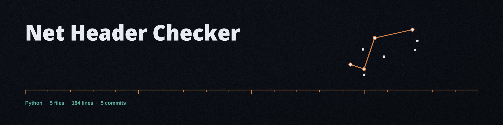

# net-header-checker
Inspects HTTP headers of a given URL, identifying security-related headers and reporting on their presence and configuration. Focused on Basic network operations.

## Install
```bash
git clone https://github.com/ShadowGuard-AI/net-header-checker.git
cd net-header-checker
pip install -r requirements.txt
```

Python 3 plus the `requests` package (see `requirements.txt`).

## Usage
```bash
python3 main.py URL [-v] [-t SECONDS]
```

## Parameters
- `url`: The URL to inspect, for example `https://www.example.com`. Required. Validation is a shape check only: a scheme and a netloc must be present, so a non-HTTP scheme with a netloc passes validation and fails later inside requests.
- `-v`, `--verbose`: Enable verbose output (debug logging).
- `-t`, `--timeout`: Request timeout in whole seconds. Default: 10. Fractional values are rejected by argparse.
- `-h`, `--help`: Show help message and exit.

## Headers reported
Presence and value are reported for: HSTS (`Strict-Transport-Security`), `X-Frame-Options`, `X-Content-Type-Options`, `Content-Security-Policy`, `Referrer-Policy`, and `Permissions-Policy` (with a `Feature-Policy` fallback for older servers). Values are never graded, so an HSTS policy with `max-age=0` sits in the report looking the same as a one year policy.

## Behaviour and limits
- Redirects are followed, and a GET request is sent.
- A 4xx or 5xx answer returns no report at all: `raise_for_status` turns it into a failed retrieval, even though the server did send headers, so error pages are exactly where missing headers are understated.
- Verified in Wave 12: `https://example.com` reports all six headers as Not Present, and a schemeless URL exits 1 with an invalid URL error.

## Exit codes
- `0`: the headers were retrieved and the report printed.
- `1`: invalid URL, or headers could not be retrieved.
- `2`: missing or mistyped argument (argparse).

## License
MIT. See [LICENSE](LICENSE).
